


✦ [About](#about) · [Engineering × AI](#engineering) · [New: micro1 eval](#hackathon) · [The talk](https://www.youtube.com/watch?v=JYRgS2VCLQQ) · [Building now](#building) · [How it fits](#architecture) · [Where Tnega was born](#born) · [Projects](#projects) · [Photography](#photography) · [Toolkit](#toolkit) · [Learning](#learning) · [Say hi](#contact) ✦

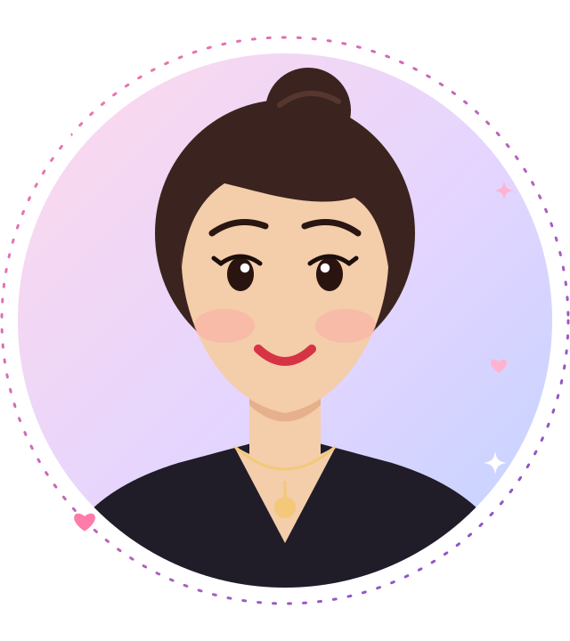

I'm a **structural engineer** (MSc, Kharazmi University) who now works where engineering meets AI. I design expert-level structural engineering tasks that show where AI models go wrong when they apply **ACI 318** and **ASCE 7**, often in a different edition from the one the project's jurisdiction adopted, and I check every expected answer by hand against the code. I also build the tools that measure it: an open-source **[evaluation harness](https://github.com/sabaazdn73/expert-eval-harness)** and a private library of the adopted code editions.

Before that I worked on a cast-in-place reinforced concrete project, doing the full **quantity takeoff and cost estimate** and supervising foundation and rebar work on site. I also hold an **MSc in Business from Católica Lisbon**.

Everything I build follows one idea: **results you can verify**. Today that's **[Tnega](https://www.tnega.app)**, an AI reviewer for structural drawings that I'm building, and Fendi, the cat in the banner, is its mascot. Away from engineering I am a photographer: see [Photography](#photography).

<table>
<tr>
<td><a href="https://www.linkedin.com/in/saba-azadegan-2974b622a"></a></td>
<td><a href="https://www.tnega.app/town/"></a></td>
</tr>
<tr>
<td><a href="cv/"></a></td>
<td></td>
</tr>
</table>

<a href="https://www.tnega.app/town/">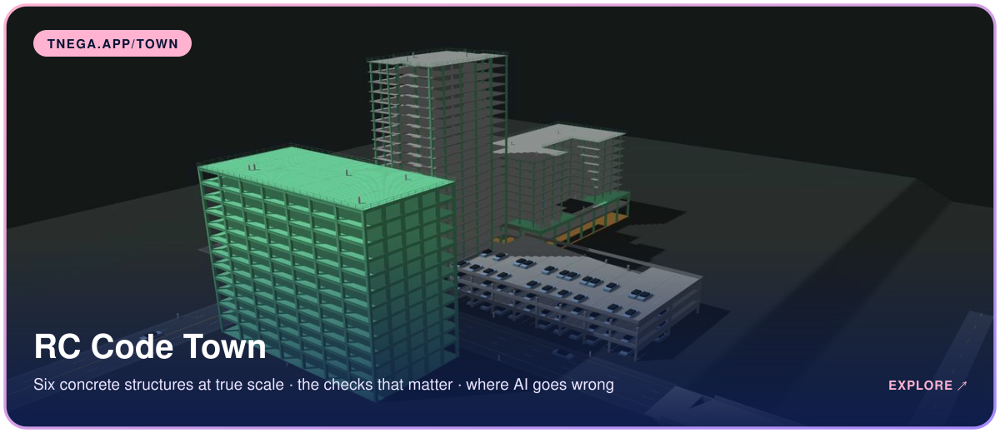</a>

▶️ **[Watch the talk on YouTube](https://www.youtube.com/watch?v=JYRgS2VCLQQ)**: how a realistic engineering task is designed, how AI models attempt it and are graded against an answer key, and why a structural engineer stays in control of the loop.

General AI models read drawings well. Where they go wrong is **applying the code**: an outdated code edition, a multi-part clause checked for only its first condition, a site input assumed instead of asked for. The **[RC Code Town](https://www.tnega.app/town/)** maps those failure points member by member, from footings and columns to transfer girders and tied-back shoring, using general engineering content from the public codes.

<a href="https://www.youtube.com/watch?v=IWcEG7c-mQU">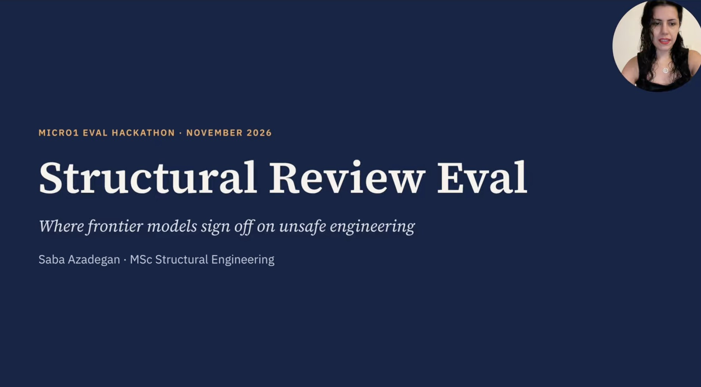</a>

▶️ **[Watch the walkthrough on YouTube](https://www.youtube.com/watch?v=IWcEG7c-mQU)** (under 5 minutes)

**Structural Review Eval** (micro1 Eval Hackathon, November 2026): six review packages for one parking structure in Salt Lake City, each with drawings, calculations, submittals and a junior engineer's draft review that looks finished and is wrong. Four frontier models (Claude Haiku 5.5, Claude Sonnet 5.5, Gemini 3.8 Flash, Gemini 4 Argon) ran 42 trials, scored item by item against my expert answer keys by two graders from different model families (96% item agreement, kappa 0.91).

- **0 of 42 passed.** The models did the arithmetic (100% of the computation items) but used the neighbouring clause, an older code edition, or skipped checks the draft never raised.
- **The sandbox changed a score.** In Vertex AI's own code tool Gemini 4 Argon wrote no answer on the hardest task; in one local sandbox shared by all models it scored 8 of 14.
- **With the code library as look-up tools, 13 of 42 passed.** Governing-clause items rose from 0% to 73%, but one required check was still missed by every answer, and 10 trials ran out of turns while still reading.

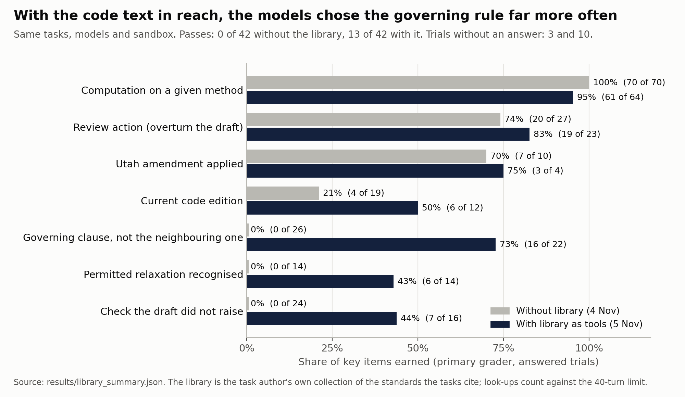

**[Tnega](https://www.tnega.app)** is an AI reviewer for structural drawings, **in development**. It will read the drawing set, run the checks for each member, do the calculations in deterministic code rather than in the model, repeat every check independently, and send every life-safety finding to an engineer first. The engineer of record signs, not the agent.

The earlier product, **[Tnega Finance](https://www.tnega.app/finance)**, still runs: it shows what every tokenized stock and ETF costs to buy on every chain, and orders are **signed in your own wallet**, so Tnega never holds keys or funds.

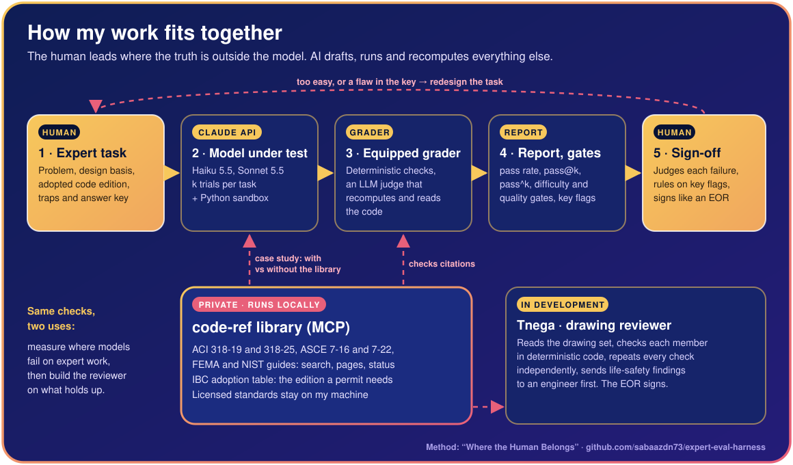

**What I'm working on now:**

- **[expert-eval-harness](https://github.com/sabaazdn73/expert-eval-harness)** runs expert tasks on Claude and Gemini models, in one local sandbox shared by all of them, and grades them against a full expert answer key, item by item. The grader is equipped: it recomputes the numbers in a code sandbox, checks the figures against the input files, reads the governing clause in the code library, and flags possible problems in the key itself for a human to review. It reports pass@k and pass^k and gates tasks on difficulty and releases on quality.
- **A case study:** does giving a smaller model the right code library (the edition the jurisdiction actually adopted) fix the errors it makes on structural tasks? The same tasks run with and without the library, and the report lists what the model looked up. First result, from the [hackathon run](#hackathon): passes rose from 0 to 13 of 42, mostly because the governing clause was found.
- **The method behind it**, [Where the Human Belongs](https://github.com/sabaazdn73/expert-eval-harness/blob/main/docs/where-the-human-belongs.md): the human leads where the truth is outside the model (jurisdiction, adopted edition, real site status) or where an AI error would run in the same direction as the test. AI drafts, builds files and repeats calculations.
- **A code library as an MCP server**, private because the standards are licensed: full-text search across ACI 318, ASCE 7 and FEMA and NIST guides, edition status, and an IBC adoption table that answers which edition a permit actually needs.


Tnega did not start from nothing. It began at the **University of Zurich's Deep Dive Into Blockchain** summer school, as **F2F Cross-Border & OnChain Oversight**, became Tnega Finance, and is now turning to the work I know best: structural engineering.

<table>
<tr>
<td><a href="https://github.com/sabaazdn73/tnega"></a></td>
<td><a href="https://github.com/sabaazdn73/Cross-Border-Payments-DDiB2026-OG04"></a></td>
</tr>
<tr>
<td><a href="https://github.com/sabaazdn73/DIVG"></a></td>
<td><a href="https://github.com/sabaazdn73/TrustCycle"></a></td>
</tr>
<tr>
<td><a href="https://github.com/sabaazdn73/expert-eval-harness"></a></td>
<td><a href="https://github.com/sabaazdn73/heygen-avatar-director-skill-for-claude"></a></td>
</tr>
<tr>
<td><a href="https://github.com/sabaazdn73/gemini-veo-studio-skill-for-claude"></a></td>
<td></td>
</tr>
</table>

<a href="https://www.tnega.app/photography/">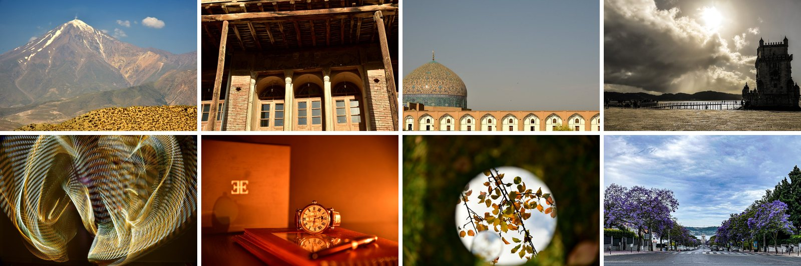</a>

I studied photography for about two years, first in the photography course at the **University of Tehran** and then on my own, and I have photographed since 2017: landscape, architecture and interiors, still life, product and food, and light painting. **204 photographs in 16 albums**, taken on a Nikon D810 in Iran and on a phone in Lisbon and Cascais, are in my **[portfolio on tnega.app](https://www.tnega.app/photography/)**.

**New: AI images made from my own photographs.** I ran **ComfyUI**, the open-source image tool, on my own laptop and made 24 images. Each one starts from a blend of two of my photographs that share an idea (Damavand under a light painting, the Sheikh Lotfollah dome beside the Tagus, the bridges of Lisbon and Tehran) and is reworked image to image with the open DreamShaper 8 LCM model. **[See the album](https://www.tnega.app/photography/#comfyui)**.

I also design brand images and logos with Gemini, ChatGPT and Claude (19 works in the [Digital art album](https://www.tnega.app/photography/#digital)) and make short videos with Veo through my own [Gemini Veo Studio](https://github.com/sabaazdn73/gemini-veo-studio-skill-for-claude) skill.


- ✦ **Solana Fall School**: PDAs, CPI, LiteSVM and the Anchor constraint system
- ✦ **Deep Dive Into Blockchain**, University of Zurich, 2026
- ✦ **Google for Startups Immersion EMEA**, powered by Antler


