


✦ [About](#about) · [Engineering × AI](#engineering) · [The talk](https://www.youtube.com/watch?v=JYRgS2VCLQQ) · [Building now](#building) · [Where Tnega was born](#born) · [Projects](#projects) · [Toolkit](#toolkit) · [Learning](#learning) · [Say hi](#contact) ✦

I'm a **structural engineer** (MSc, Kharazmi University) who now works where engineering meets AI. I design expert-level structural engineering tasks that show where AI models go wrong when they apply **ACI 318-19** and **ASCE 7-16**, and I check every expected answer by hand against the code.

Before that I worked on a cast-in-place reinforced concrete project, doing the full **quantity takeoff and cost estimate** and supervising foundation and rebar work on site. I also hold an **MSc in Business from Católica Lisbon**.

Everything I build follows one idea: **results you can verify**. Today that's **[Tnega](https://www.tnega.app)**, an AI reviewer for structural drawings that I'm building, and Fendi, the cat in the banner, is its mascot.

<table>
<tr>
<td><a href="https://www.linkedin.com/in/saba-azadegan-2974b622a"></a></td>
<td><a href="https://www.tnega.app/town/"></a></td>
</tr>
<tr>
<td><a href="cv/"></a></td>
<td></td>
</tr>
</table>

<a href="https://www.tnega.app/town/">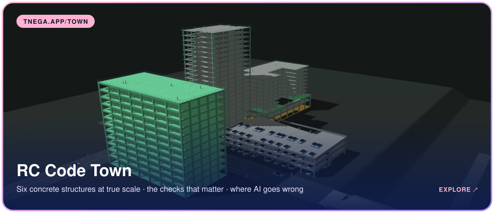</a>

<table>
<tr>
<td width="58%"></td>
<td width="42%"><a href="https://www.youtube.com/watch?v=JYRgS2VCLQQ"></a></td>
</tr>
</table>

▶️ **[Watch the talk on YouTube](https://www.youtube.com/watch?v=JYRgS2VCLQQ)**: how a realistic engineering task is designed, how AI models attempt it and are graded against an answer key, and why a structural engineer stays in control of the loop.

General AI models read drawings well. Where they go wrong is **applying the code**: an outdated code edition, a multi-part clause checked for only its first condition, a site input assumed instead of asked for. The **[RC Code Town](https://www.tnega.app/town/)** maps those failure points member by member, from footings and columns to transfer girders and tied-back shoring, using general engineering content from the public codes.

**[Tnega](https://www.tnega.app)** is an AI reviewer for structural drawings, **in development**. It will read the drawing set, run the checks for each member, do the calculations in deterministic code rather than in the model, repeat every check independently, and send every life-safety finding to an engineer first. The engineer of record signs, not the agent.

The earlier product, **[Tnega Finance](https://www.tnega.app/finance)**, still runs: it shows what every tokenized stock and ETF costs to buy on every chain, and orders are **signed in your own wallet**, so Tnega never holds keys or funds.


Tnega did not start from nothing. It began at the **University of Zurich's Deep Dive Into Blockchain** summer school, as **F2F Cross-Border & OnChain Oversight**, became Tnega Finance, and is now turning to the work I know best: structural engineering.

<table>
<tr>
<td><a href="https://github.com/sabaazdn73/tnega"></a></td>
<td><a href="https://github.com/sabaazdn73/Cross-Border-Payments-DDiB2026-OG04"></a></td>
</tr>
<tr>
<td><a href="https://github.com/sabaazdn73/DIVG"></a></td>
<td><a href="https://github.com/sabaazdn73/TrustCycle"></a></td>
</tr>
<tr>
<td colspan="2" align="center"></td>
</tr>
</table>


- ✦ **Solana Fall School**: PDAs, CPI, LiteSVM and the Anchor constraint system
- ✦ **Deep Dive Into Blockchain**, University of Zurich, 2026
- ✦ **Google for Startups Immersion EMEA**, powered by Antler


