

✦ [About](#about) · [AI evaluation](#ai-evaluation) · [Mini dApps](#mini-dapps) · [Mini apps](#mini-apps) · [Research](#research) · [Claude skills](#claude-skills) · [Photography](#photography) · [Toolkit](#toolkit) · [Courses](#courses) · [Contact](#contact) ✦

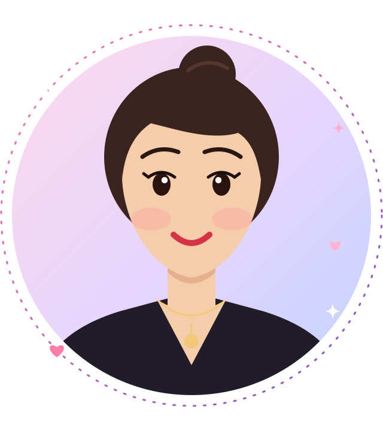

I'm a structural engineer (MSc, Kharazmi University) with an MSc in Business from Católica Lisbon. In 2018 I worked on site on a reinforced concrete building: the quantity takeoff, the cost estimate and supervision of foundation and rebar work.

I have worked with AI for about a year: first on web3 projects, and since August 2026, as a freelancer in Portugal, on testing AI models on structural engineering tasks. My CV is in [cv/](cv/).

<a href="https://www.youtube.com/watch?v=IWcEG7c-mQU">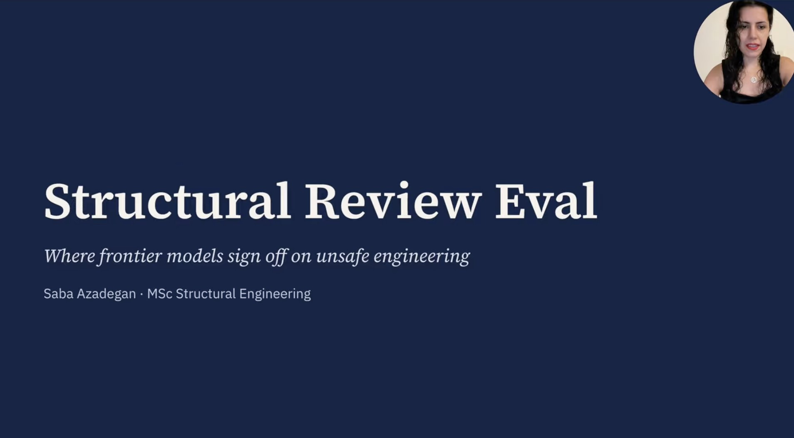</a>

▶️ **[Watch the walkthrough on YouTube](https://www.youtube.com/watch?v=IWcEG7c-mQU)** (under 5 minutes)

**Structural Review Eval** (November 2026, entered in the micro1 Eval Hackathon): six review packages for one parking structure in Salt Lake City, each with drawings, calculations, submittals and a junior engineer's draft review that looks finished and is wrong. Four models (Claude Haiku 5.5, Claude Sonnet 5.5, Gemini 3.8 Flash, Gemini 4 Argon) ran 42 trials, scored item by item against my answer keys by two graders from different model families (96% item agreement, kappa 0.91).

- **0 of 42 passed.** The models did the arithmetic (100% of the computation items) but used the neighbouring clause, an older code edition, or skipped checks the draft never raised.
- **The sandbox changed a score.** In Vertex AI's own code tool Gemini 4 Argon wrote no answer on the hardest task; in one local sandbox shared by all models it scored 8 of 14.
- **With the code library as look-up tools, 13 of 42 passed.** Governing-clause items rose from 0% to 73%, but one required check was still missed by every answer, and 10 trials ran out of turns while still reading.

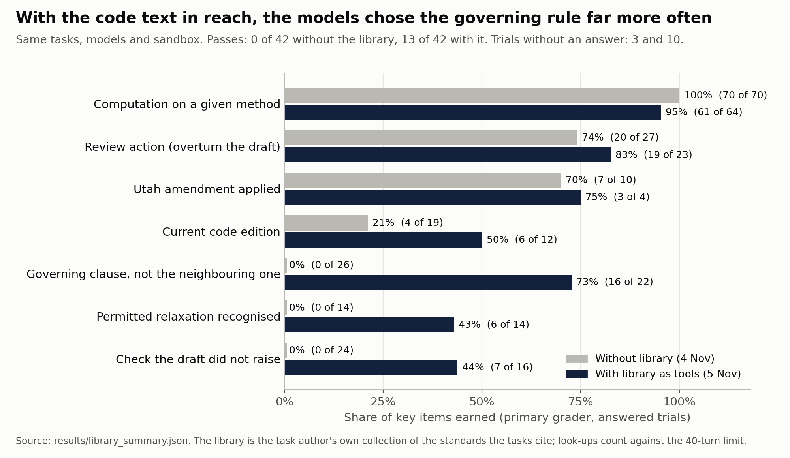

The tools behind it:

- **[expert-eval-harness](https://github.com/sabaazdn73/expert-eval-harness)**: runs expert tasks on Claude and Gemini models in one local sandbox and grades each answer item by item against an expert key. The grader recomputes numbers in a code sandbox, checks figures against the input files and reads the governing clause in the code library. It reports pass@k and pass^k and gates tasks on difficulty and quality.
- **A task pipeline dashboard**: the stages and human gates for building a task. A read-only copy, without prompts, keys or traps: [tnega.app/eval](https://www.tnega.app/eval/).
- **A code library as an MCP server**, private because the standards are licensed: search across ACI 318, ASCE 7 and FEMA and NIST guides, edition status, and an IBC adoption table.
- **[Where the Human Belongs](https://github.com/sabaazdn73/expert-eval-harness/blob/main/docs/where-the-human-belongs.md)**: which steps a person must check, such as the adopted code edition or the real site status, and which can go to AI.
- **[RC Code Town](https://www.tnega.app/town/)**: six concrete structures in 3D, the governing provisions and where AI tends to go wrong. It sits on [tnega.app](https://www.tnega.app), where I am also building an AI reviewer for structural drawings; it does not review drawings yet.
- **[A talk](https://www.youtube.com/watch?v=JYRgS2VCLQQ)** on how a task like these is designed, attempted by a model and graded.

### Mini dApps

<table>
<tr>
<td><a href="https://www.tnega.app/finance"></a></td>
<td><a href="https://github.com/sabaazdn73/Cross-Border-Payments-DDiB2026-OG04"></a></td>
</tr>
<tr>
<td><a href="https://github.com/sabaazdn73/TrustCycle"></a></td>
<td></td>
</tr>
</table>

### Mini apps

<table>
<tr>
<td><a href="https://www.tnega.app/hava/"></a></td>
<td><a href="https://github.com/sabaazdn73/open-structural-bim-course"></a></td>
</tr>
<tr>
<td colspan="2" align="center"><a href="https://www.tnega.app/notebook/"></a></td>
</tr>
</table>

Hava runs in the browser and the camera picture is never uploaded ([2-minute demo](https://www.youtube.com/watch?v=C0T4-EIfYHc)). The BIM course checker also runs in the browser at [tnega.app/bim](https://www.tnega.app/bim/).

### Research

<table>
<tr>
<td></td>
<td><a href="https://github.com/sabaazdn73/DIVG"></a></td>
</tr>
</table>

Also: [structural reliability of reclaimed steel](https://github.com/sabaazdn73/reclaimed-steel-reliability), FORM in Python checked against importance sampling and Monte Carlo, and two sole-author conference abstracts under review (EG-ICE 2027, ISEC-2027) on where language models fail in structural review.

### Claude skills

<table>
<tr>
<td><a href="https://github.com/sabaazdn73/heygen-avatar-director-skill-for-claude"></a></td>
<td><a href="https://github.com/sabaazdn73/gemini-veo-studio-skill-for-claude"></a></td>
</tr>
</table>

I have photographed since 2017, after about two years of study that started with the photography course at the University of Tehran: landscape, architecture and interiors, still life, product and food, and light painting. 238 photographs in 16 albums, on a Nikon D810 in Iran and on a phone in Lisbon and Cascais, are in my [portfolio](https://www.tnega.app/photography/).

I also made 24 images with ComfyUI on my laptop, each from a blend of two of my photographs ([album](https://www.tnega.app/photography/#comfyui)), and brand images and logos with Gemini, ChatGPT and Claude ([Digital art album](https://www.tnega.app/photography/#digital)).


The languages and chains used in my web3 projects. I build with Claude Code; my own programming is basic.

- Google Cloud Professional Agentic Architect, in progress since November 2026
- Anthropic Claude Academy: Introduction to Evals and AI Fluency, in progress
- Deep Dive into Blockchain, University of Zurich International Summer School, 2026
- Solana Fall School, 2026
- Google for Startups Immersion EMEA, powered by Antler, 2026

