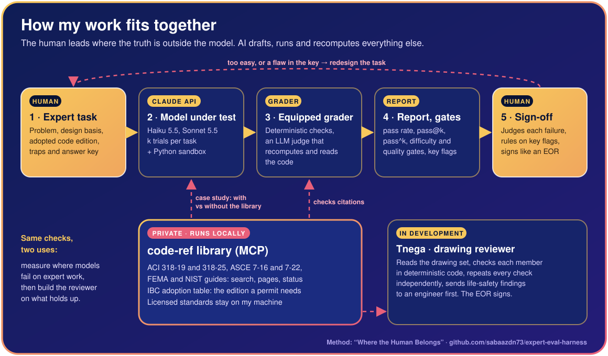
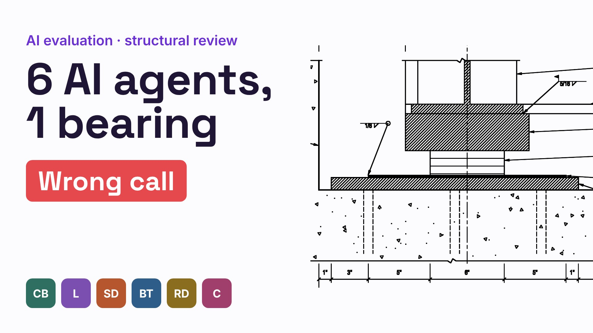
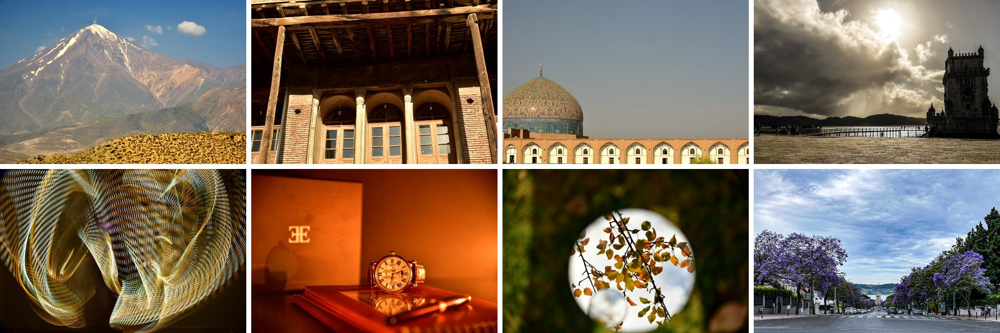

✦ [About](#about) · [AI evaluation](#ai-evaluation) · [Team review](#team-review) · [Research](#research) · [Other work](#other-work) · [Photography](#photography) · [Toolkit](#toolkit) · [Courses](#courses) · [Contact](#contact) ✦

I'm a structural engineer (MSc, Kharazmi University) with an MSc in Business from Católica Lisbon. Since August 2026, as a freelancer in Portugal, I test AI models on structural engineering tasks: I write expert review tasks from realistic project documents and measure where the models get the code checks wrong. In 2018 I worked on site on a reinforced concrete building: the quantity takeoff, the cost estimate and supervision of foundation and rebar work. My CV is in [cv/](cv/).

▶️ **[Watch the walkthrough on YouTube](https://www.youtube.com/watch?v=IWcEG7c-mQU)** (under 5 minutes)

**Structural Review Eval** (November 2026, entered in the micro1 Eval Hackathon): six review packages for one parking structure in Salt Lake City, each with drawings, calculations, submittals and a junior engineer's draft review that looks finished and is wrong. Four models (Claude Haiku 5.5, Claude Sonnet 5.5, Gemini 3.8 Flash, Gemini 4 Argon) ran 42 trials, scored item by item against my answer keys by two graders from different model families (96% item agreement, kappa 0.91).

- **0 of 42 passed.** The models did the arithmetic (100% of the computation items) but used the neighbouring clause, an older code edition, or skipped checks the draft never raised.
- **The sandbox changed a score.** In Vertex AI's own code tool Gemini 4 Argon wrote no answer on the hardest task; in one local sandbox shared by all models it scored 8 of 14.
- **With the code library as look-up tools, 13 of 42 passed.** Governing-clause items rose from 0% to 73%, but one required check was still missed by every answer, and 10 trials ran out of turns while still reading.

### Team review: six agents, one bearing

▶️ **[Watch the team review on YouTube](https://www.youtube.com/watch?v=RV5GsyJo4Ys)** (2:22)

The harness can also run one model as a review team in a shared channel: a code-basis agent settles the code editions, one agent per member checks its part, the agents ask each other with @mentions, and a checker sends wrong parts back before it writes the graded answer. On the public skybridge task, a team of Claude Sonnet 5.5 agents accepted the sliding bearing with 3.66 in. of movement; ASCE 7-22 §12.12.3 calls for 5.69 in. (6.05 in. with thermal movement) against 5 in. of travel. The task, the whole conversation and the grade are [on GitHub](https://github.com/sabaazdn73/expert-eval-harness/tree/main/docs/team-review).

The tools behind it:

- **[expert-eval-harness](https://github.com/sabaazdn73/expert-eval-harness)**: runs expert tasks on Claude and Gemini models in one local sandbox and grades each answer item by item against an expert key. The grader recomputes numbers in a code sandbox, checks figures against the input files and reads the governing clause in the code library. It reports pass@k and pass^k and gates tasks on difficulty and quality.
- **A task pipeline dashboard**: the stages and human gates for building a task. A read-only copy, without prompts, keys or traps: [tnega.app/eval](https://www.tnega.app/eval/).
- **A code library as an MCP server**, private because the standards are licensed: search across ACI 318, ASCE 7 and FEMA and NIST guides, edition status, and an IBC adoption table.
- **[Where the Human Belongs](https://github.com/sabaazdn73/expert-eval-harness/blob/main/docs/where-the-human-belongs.md)**: which steps a person must check, such as the adopted code edition or the real site status, and which can go to AI.
- **[RC Code Town](https://www.tnega.app/town/)**: six concrete structures in 3D, the governing provisions and where AI tends to go wrong. It sits on [tnega.app](https://www.tnega.app), where I am also building an AI reviewer for structural drawings; it does not review drawings yet.
- **[Review notebook](https://www.tnega.app/notebook/)**: structural engineering fundamentals, each section with a worked example and a trap to test on AI models.
- **[A talk](https://www.youtube.com/watch?v=JYRgS2VCLQQ)** on how a task like these is designed, attempted by a model and graded.

### Research

- **Can an AI-drafted review be signed? Language model errors in concrete design review**: sole author, manuscript under review at ISEC-2027 (Pomona, California).
- **Where language models fail in structural engineering review: expert-designed tasks and the code-edition trap**: sole author, abstract under review at EG-ICE 2027 (Lund, Sweden).
- **Damage detection in bridges** (MSc research, Kharazmi University): damage modelled in Abaqus as local stiffness loss, and how it shifts natural frequencies and mode shapes.
- **[Structural reliability of reclaimed steel](https://github.com/sabaazdn73/reclaimed-steel-reliability)**: FORM in Python, checked against importance sampling and Monte Carlo.
- **Financial Damage Detection Index**: structural damage detection applied to company finances; accepted at the IFABS 2026 London Conference.
- **[DIVG](https://github.com/sabaazdn73/DIVG)**: Digital Identity + Verification Graph, my MSc in Business thesis.

### Other work: mini dApps and mini apps

- **[Tnega Finance](https://www.tnega.app/finance)**: the real cost of buying a tokenised stock, per issuer and chain.
- **[Cross-Border (F2F)](https://github.com/sabaazdn73/Cross-Border-Payments-DDiB2026-OG04)**: cross-border transfers recorded on Hedera; partner prize at ETHGlobal Lisbon 2026.
- **[TrustCycle](https://github.com/sabaazdn73/TrustCycle)**: recommendation letters that can be verified on IOTA.
- **Tnega receipts** on Solana, in progress.
- **[Hava](https://www.tnega.app/hava/)**: draw in the air with your hands through the webcam ([demo](https://www.youtube.com/watch?v=C0T4-EIfYHc)).
- **[Structural BIM course](https://github.com/sabaazdn73/open-structural-bim-course)**: 32 exercises on one concrete building, with a checker for your IFC file.
- **Claude skills for video**: [HeyGen Avatar Director](https://github.com/sabaazdn73/heygen-avatar-director-skill-for-claude) and [Gemini Veo Studio](https://github.com/sabaazdn73/gemini-veo-studio-skill-for-claude).

Photography since 2017: landscape, architecture, still life and light painting. 238 photographs in 16 albums, and 24 ComfyUI images made from my own photographs, are in my [portfolio](https://www.tnega.app/photography/).

I build my tools with Claude Code; my own programming is basic. The mini dApps use Solidity, Move, Rust and TypeScript on Hedera, SUI, IOTA, Solana, BNB and Arbitrum.

- Google Cloud Professional Agentic Architect, in progress since November 2026
- Anthropic Claude Academy: Introduction to Evals and AI Fluency, in progress
- Deep Dive into Blockchain, University of Zurich International Summer School, 2026
- Solana Fall School, 2026
- Google for Startups Immersion EMEA, powered by Antler, 2026

